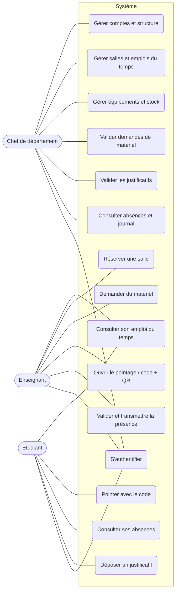
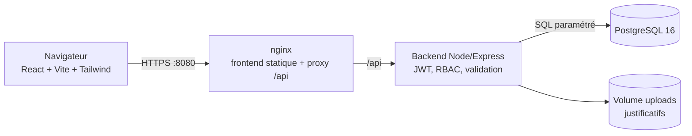
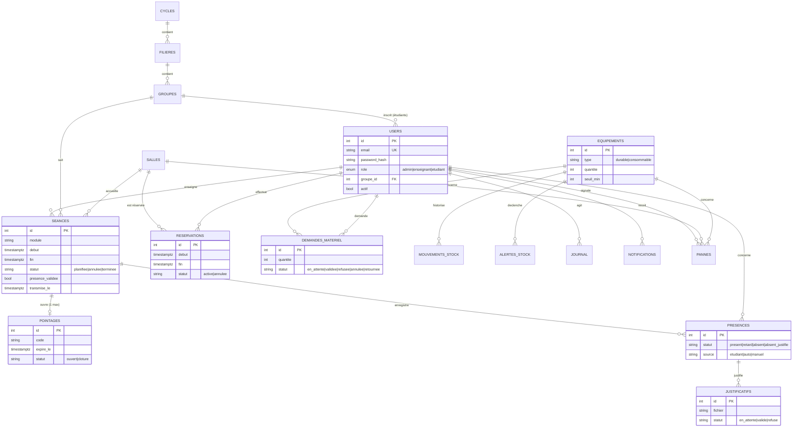
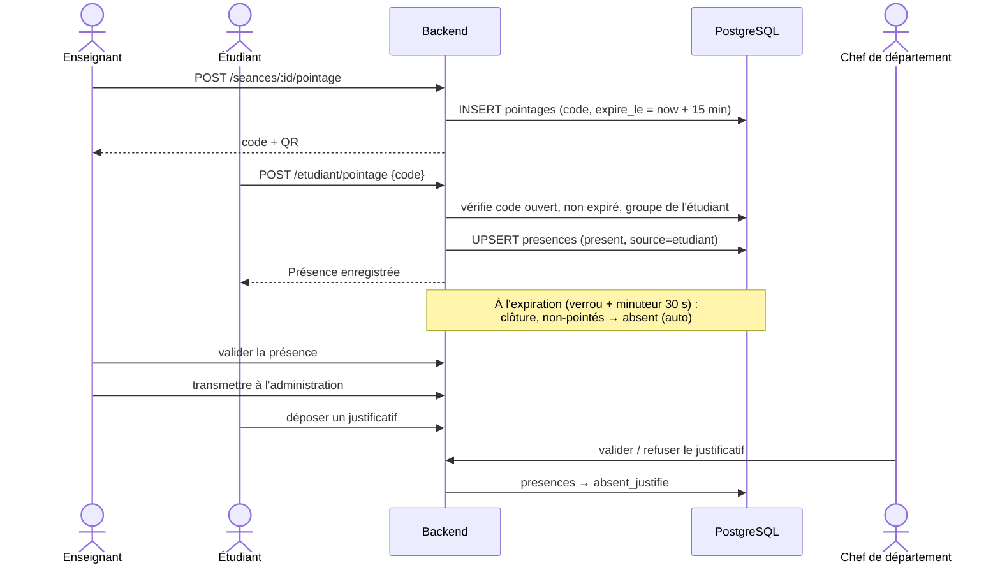
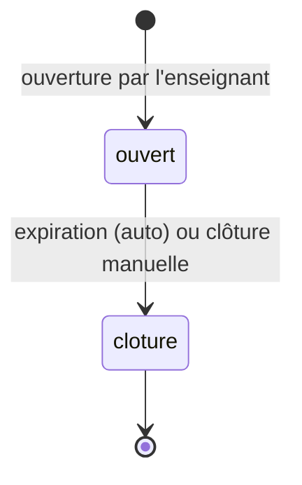
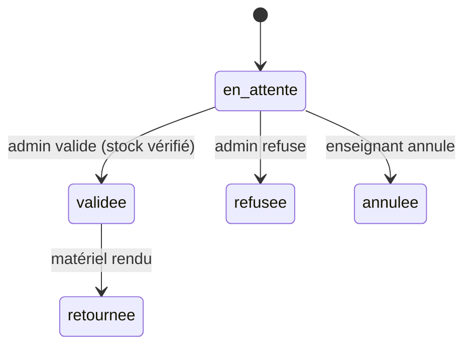

# Dossier de conception — Gestion du département informatique (FST Tanger)

> Les diagrammes sont en Mermaid : ils s'affichent directement sur GitHub et dans VS Code (extension « Markdown Preview Mermaid Support »).

## 1. Acteurs et besoins

| Acteur | Rôle |
|---|---|
| **Chef de département** (admin) | Gère comptes, structure (cycles/filières/groupes), salles, emplois du temps, stock ; valide demandes de matériel et justificatifs ; consulte les absences et le journal. |
| **Enseignant** | Consulte son emploi du temps, réserve des salles libres, demande du matériel, ouvre le pointage, valide la liste de présence et la transmet. |
| **Étudiant** | Consulte son emploi du temps, pointe avec le code/QR, consulte ses absences, dépose un justificatif. |

Fonctionnalités **Must** : agenda et réservation des salles (détection de conflits, libération dynamique), matériel et stock (pas de double réservation, alerte sous le seuil), pointage dématérialisé (code temporaire ~15 min, clôture automatique → absent, validation enseignant, transmission à l'admin, justificatifs).

## 2. Cas d'utilisation

## 3. Architecture

- **Réseaux Docker** : `frontend-net` (nginx ↔ backend) et `backend-net` (backend ↔ base). La base n'est jamais exposée.
- **Volumes** : `pgdata` (données), `uploads` (pièces justificatives).
- **Couches backend** : `routes` (HTTP, droits) → `services` (règles métier : conflits, stock, pointage) → `db` (SQL paramétré).

## 4. Modèle conceptuel / logique des données

### Contraintes d'intégrité clés (garanties par la base)

| Règle | Mécanisme |
|---|---|
| Pas de chevauchement pour une salle, un enseignant ou un groupe | `EXCLUDE USING gist (… tstzrange(debut, fin) WITH &&) WHERE statut <> 'annulee'` |
| Pas de double réservation d'une salle | idem sur `reservations` (`WHERE statut = 'active'`) |
| Une séance/réservation annulée libère la ressource | la clause `WHERE` exclut le statut annulé |
| Un étudiant a toujours un groupe | `CHECK (role <> 'etudiant' OR groupe_id IS NOT NULL)` |
| Un seul pointage par séance ; une présence par (séance, étudiant) | `UNIQUE (seance_id)`, `UNIQUE (seance_id, etudiant_id)` |
| Une seule alerte de stock active par équipement | index unique partiel `WHERE NOT resolue` |
| Quantités et périodes cohérentes | `CHECK (quantite >= 0)`, `CHECK (fin > debut)` |

## 5. Règles de gestion

- **Salles** : une salle ne peut pas être occupée deux fois sur un même créneau, ni par une séance ni par une réservation. Annuler libère immédiatement le créneau. Les conflits sont renvoyés avec une erreur 409.
- **Matériel durable** : une demande validée réserve des unités sur la période ; la somme des unités réservées ne dépasse jamais la quantité possédée (verrou `FOR UPDATE` + verrou consultatif pour éviter la double réservation en concurrence).
- **Consommable** : la validation décrit une sortie de stock. Une alerte est créée dès que `quantite < seuil_min` et se résout au réapprovisionnement.
- **Pointage** : le code est valide `POINTAGE_MINUTES` (15 par défaut). À l'expiration, les étudiants du groupe sans pointage passent automatiquement en `absent` (source `auto`).
- **Validation** : l'enseignant peut corriger la liste, la valider, puis la transmettre à l'administration.
- **Justificatif** : l'étudiant dépose un PDF/JPEG/PNG (5 Mo max) pour une absence. L'admin le valide (l'absence devient `absent_justifie`) ou le refuse.

## 6. Dynamique du pointage

## 7. Sécurité (conception)

| Menace | Contre-mesure |
|---|---|
| Accès non autorisé | JWT (HS256) ; le rôle est relu en base à chaque requête ; **RBAC strict côté serveur** (403) ; comptes désactivés bloqués immédiatement |
| Mots de passe | bcrypt ; limitation de débit sur la connexion et le pointage |
| Injection SQL | requêtes 100 % paramétrées, validation des types/identifiants |
| XSS | suppression récursive du HTML dans les entrées ; React échappe l'affichage ; en-têtes Helmet |
| CSRF | authentification par en-tête `Bearer` (pas de cookie) + contrôle de l'`Origin` et du `Content-Type` ; CORS en liste blanche |
| Fichiers | types autorisés, vérification des octets magiques, nom aléatoire, 5 Mo |
| Traçabilité | table `journal` (qui, quoi, quand, IP) |

## 8. Stratégie de test et déploiement

- **Tests** (`/tests`) : unitaires (règles, validation), intégration (salles, stock, pointage) et sécurité (RBAC 403, injection SQL, XSS, CSRF), exécutés sur une vraie base PostgreSQL.
- **CI/CD** (GitHub Actions) : lint → tests → build frontend → build Docker + test de fumée + test de sauvegarde → publication des images (GHCR).
- **Exploitation** : `docker compose up`, sauvegarde `scripts/backup_db.sh` (cron), restauration `scripts/restore_db.sh`.

## 9. Écarts avec le document « Conception UML » de l'équipe (groupe n° 3)

Fonctions du document **ajoutées** : notifications (UC28), statut `RETARD`, alertes de seuil d'absences et de retard de retour, signalement de panne (UC15), statistiques avec export CSV (UC26), paramètres (UC30).

Écarts **conservés volontairement** (l'application fonctionnelle et testée repose dessus) :

| Document UML | Implémentation actuelle |
|---|---|
| Tables `utilisateur` + `etudiant` (numéro) + `enseignant` (spécialité) | table unique `users` (rôle + groupe) |
| Table `module` liée à la filière | module saisi en texte dans la séance |
| Table `occupation_salle` unifiant séances et réservations | contraintes d'exclusion sur `seances` et `reservations`, contrôle croisé dans le service `conflicts` |
| Salles : types AMPHI/COURS/LABO/REUNION, bâtiment, étage, état | types cours/tp/amphi, sans bâtiment ni étage |
| Tables `materiel` (prêtable) et `article_stock` (consommables) | table unique `equipements` (type durable/consommable) |
| Statut de demande `PRETEE` (routes `/pret` et `/retour`) | validée → retournée (pas d'étape « prêtée ») |
| Table `rapport_seance` (en attente → validé → transmis) | colonnes `presence_validee` et `transmise_le` de `seances` |
| JWT en cookie HttpOnly | JWT en en-tête `Authorization: Bearer` (protection CSRF par conception) |
| Routes REST `/utilisateurs`, `/emploi-du-temps`, `/seances/{id}/rapport/valider`… | routes équivalentes sous `/api/admin/...`, `/api/seances/...` |
| Export PDF/Excel, e-mails | export CSV (Excel) ; notifications internes seulement |
